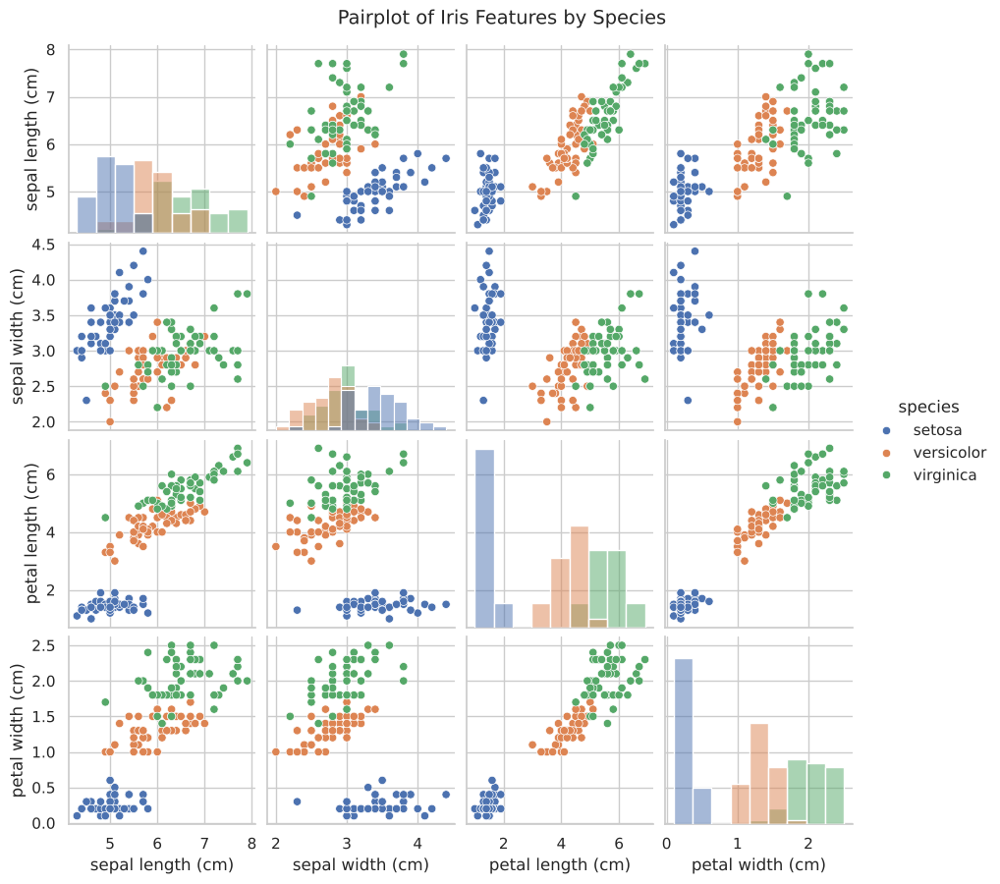
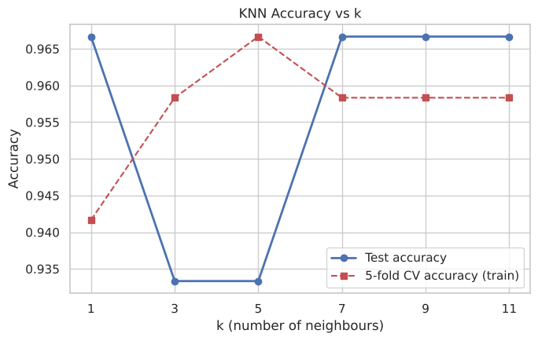
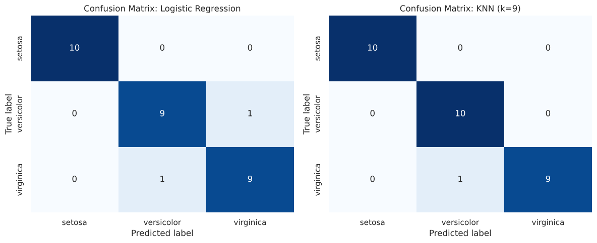

# Iris Species Classification: Logistic Regression vs KNN

A small end-to-end machine learning project on the classic Iris dataset. I explore the data, prepare it, train two classifiers with scikit-learn, and compare them.

> **Note:** This project was done as Assignment 01 for the Data Science course (BSCS, Fall 2026) at SZABIST University, Gharo Campus.

**Author:** Junaid Memon (2312226)

## What the project covers

- Loading and inspecting the data with pandas
- Preprocessing: missing value and duplicate checks, label encoding, stratified 80/20 split, `StandardScaler` (fit on train only)
- Exploratory data analysis: descriptive statistics, histograms, pairplot, box plots, correlation heatmap
- Models: Logistic Regression and K-Nearest Neighbors (k = 1, 3, 5, 7, 9, 11)
- Evaluation: accuracy, confusion matrix, precision / recall / F1
- Predicting a new flower sample

## Results

| Model | Test Accuracy | Wrong predictions (out of 30) |
|---|---|---|
| Logistic Regression | 93.33% | 2 |
| **KNN (k = 9)** | **96.67%** | **1** |

k = 9 was picked from the plateau of equally good values (7, 9, 11), using 5-fold cross-validation on the training data to break the tie. k = 1 was avoided because it is too sensitive to noise.

The new sample `[5.1, 3.5, 1.4, 0.2]` is predicted as **setosa**.

## Key findings

- Petal length and petal width separate the species best.
- Setosa is completely separable and was never misclassified.
- Versicolor and virginica overlap, so all model errors are between these two.
- Limitation: only 150 samples (30 in the test set), so one prediction changes accuracy by 3.3%.

## Some plots





## How to run

```bash
git clone https://github.com/<your-username>/iris-classification-logreg-knn.git
cd iris-classification-logreg-knn
pip install -r requirements.txt
jupyter notebook 2312226_JunaidMemon_A01.ipynb
```

## Files

- `2312226_JunaidMemon_A01.ipynb`: the full notebook with outputs
- `2312226_JunaidMemon_A01.pdf`: PDF export of the notebook
- `images/`: plots used in this README

## Tools

Python, pandas, NumPy, Matplotlib, Seaborn, scikit-learn
